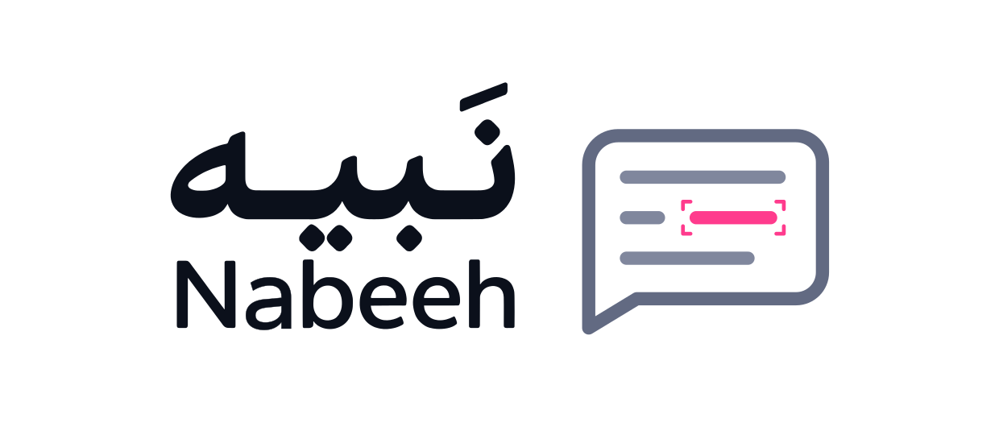
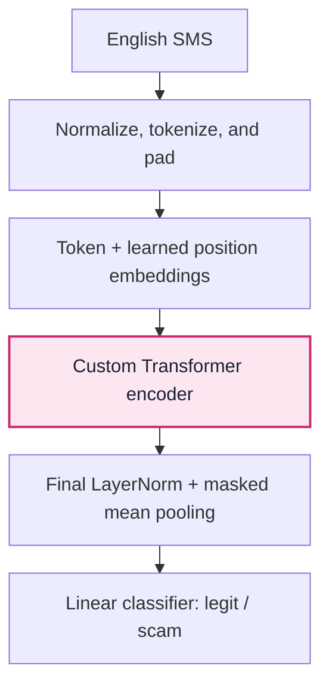

<h1 align="center">
  <picture>
    <source media="(prefers-color-scheme: dark)" srcset="assets/branding/nabeeh-logo-transparent.svg">
    <source media="(prefers-color-scheme: light)" srcset="assets/branding/nabeeh-logo-light.svg">
    
  </picture>
</h1>

<p align="center">SMS spam detection with a Transformer encoder built from scratch in PyTorch.</p>

<p align="center">
  <a href="https://huggingface.co/spaces/AliyahAlabdali/sms-scam-detector">Live demo</a> ·
  <a href="SMS_Scam_Detection_Transformer.ipynb">Training notebook</a> ·
  <a href="https://colab.research.google.com/github/AliyahAlabdali/Nabeeh/blob/main/SMS_Scam_Detection_Transformer.ipynb">Open in Colab</a>
</p>

Nabeeh classifies English SMS messages as `legit` or `scam`. The project implements scaled dot-product attention, multi-head attention, and a pre-LayerNorm encoder directly in PyTorch, without `nn.Transformer` or pretrained language-model weights. The notebook covers component tests, data preparation, training, evaluation, and inference.

[How it works](#how-it-works) · [Results](#results) · [Dataset](#dataset) · [Run the notebook](#run-the-notebook)

## Demo

[Try the Hugging Face Space](https://huggingface.co/spaces/AliyahAlabdali/sms-scam-detector) to classify a message, inspect its class probabilities, and see word-level influence.

<p align="center">
  <a href="https://huggingface.co/spaces/AliyahAlabdali/sms-scam-detector">
    
  </a>
</p>

The demo estimates influence by masking one normalized token at a time and measuring the change in `p(scam)`. Red indicates a positive contribution to the scam score; blue indicates a negative contribution. These are token-occlusion scores, not attention weights or causal explanations.

## How it works



The encoder applies layer normalization before each attention and feed-forward sublayer, with residual connections and dropout. Padding is masked in attention and excluded from pooling. The implementation includes checks for tensor shapes, softmax normalization, padding-mask behavior, and gradient flow.

### Preprocessing

- Lowercase text and replace URLs, email addresses, currency amounts, phone numbers, and remaining numbers with `<url>`, `<email>`, `<curr>`, `<phone>`, and `<num>`.
- Remove punctuation and non-Latin characters, then split on whitespace. Inputs with no remaining tokens receive `<UNK>`.
- Build the vocabulary from training messages only, keeping tokens seen at least twice. Pad or truncate sequences to a length derived from the training set's 95th percentile, clipped to 32–80 tokens.

### Model and training

The recorded baseline uses one encoder block with `d_model=64`, two attention heads, a feed-forward width of 128, and dropout of 0.1. The training vocabulary contains 3,142 entries; the sequence length is 33 tokens.

Training runs for 15 epochs with Adam, a learning rate of `1e-3`, and batches of 64. Inverse-frequency class weights are used in cross-entropy loss, and gradients are clipped to a norm of 1.0. The checkpoint with the highest validation macro-F1 is restored before test evaluation. The notebook sets random seeds to 42 and configures deterministic cuDNN behavior.

## Results

The saved notebook outputs report the following results on 517 held-out test messages. Scores are rounded to four decimal places.

| Metric | Test score |
| --- | ---: |
| Accuracy | 98.07% |
| Macro precision | 0.9743 |
| Macro recall | 0.9362 |
| Macro-F1 | 0.9542 |

Per-class scores, with test-message counts in parentheses:

| Metric | `legit` (452) | `scam` (65) |
| --- | ---: | ---: |
| Precision | 0.9825 | 0.9661 |
| Recall | 0.9956 | 0.8769 |
| F1 | 0.9890 | 0.9194 |

<p align="center">
  <a href="assets/confusion_matrix.png"></a>
</p>

The model makes 10 errors: two false alarms and eight missed spam messages. Scam recall is lower than precision, so the aggregate accuracy should be read alongside the minority-class results. These measurements describe this benchmark split, not performance on all contemporary phishing messages.

<details>
<summary>Training and validation diagnostics</summary>

Validation loss begins rising after the early epochs while macro-F1 continues to improve. Checkpoint selection uses validation macro-F1 rather than the final epoch or the minimum validation loss.

<p align="center">
  <a href="assets/training_loss.png"></a>
</p>

<p align="center">
  <a href="assets/val_vs_test.png"></a>
</p>

[View all four validation-metric curves at full resolution](assets/val_metrics.png).

</details>

### Attention-head comparison

The notebook retrains the model with four heads using the same split and training settings. Both runs produce the same rounded test metrics.

| Attention heads | Accuracy | Macro-F1 |
| --- | ---: | ---: |
| 2, baseline | 0.9807 | 0.9542 |
| 4, comparison | 0.9807 | 0.9542 |

This comparison did not show an improvement from four heads. At a fixed model width of 64, changing the head count changes how the projections are partitioned; it does not increase the number of trainable projection parameters. A single comparison does not establish that the configurations are equivalent across seeds or datasets.

<details>
<summary>Compare the two training runs</summary>

<p align="center">
  <a href="assets/ablation_loss.png"></a>
</p>

</details>

## Dataset

The notebook downloads the [Kaggle mirror](https://www.kaggle.com/datasets/uciml/sms-spam-collection-dataset) of the [UCI SMS Spam Collection](https://archive.ics.uci.edu/dataset/228/sms+spam+collection). The recorded input has 5,572 rows. After removing missing values and duplicate message texts, 5,169 messages remain: 4,516 legitimate messages and 653 spam messages, or 12.6% spam.

The original labels are `ham` and `spam`. The project maps them to `legit` and `scam`; the latter is a spam-class label, not a verified fraud annotation for every message.

Duplicates are removed before a stratified split. The vocabulary and sequence length are fitted using the training partition only.

| Partition | Messages |
| --- | ---: |
| Training | 4,135 |
| Validation | 517 |
| Test | 517 |

<details>
<summary>Class balance and vocabulary</summary>

<p align="center">
  <a href="assets/class_distribution.png"></a>
</p>

<p align="center">
  <a href="assets/top_words.png"></a>
</p>

</details>

## Run the notebook

### Google Colab

Open the [notebook in Colab](https://colab.research.google.com/github/AliyahAlabdali/Nabeeh/blob/main/SMS_Scam_Detection_Transformer.ipynb), optionally select a T4 GPU under **Runtime > Change runtime type**, and run the cells in order. The notebook downloads the dataset and trains the model. A CPU is also supported by the device-selection logic.

### Local environment

Use Python 3.10 or newer. Jupyter Notebook is installed explicitly below because it is not listed in `requirements.txt`.

```bash
git clone https://github.com/AliyahAlabdali/Nabeeh.git
cd Nabeeh
python -m venv .venv
source .venv/bin/activate
python -m pip install -r requirements.txt notebook
python -m notebook SMS_Scam_Detection_Transformer.ipynb
```

On Windows PowerShell, replace the activation command with `.venv\Scripts\Activate.ps1`. An internet connection is needed for the first dataset download. Run the notebook from top to bottom so the model definitions, tests, vocabulary, and trained weights are available to later cells.

After training, use the notebook's inference helper:

```python
predict_messages(
    model,
    ["Hey, are we still meeting for lunch tomorrow at 1?"],
    vocab,
    max_len,
    device,
)
```

The repository contains the training workflow. The [Hugging Face Space files](https://huggingface.co/spaces/AliyahAlabdali/sms-scam-detector/tree/main) contain the deployed app, configuration, vocabulary, and checkpoint.

## Repository layout

```text
Nabeeh/
├── SMS_Scam_Detection_Transformer.ipynb
├── requirements.txt
├── README.md
└── assets/
    ├── branding/           # Approved logos, icons, and brand guide
    ├── scam-detector-demo.gif
    └── *.png              # Existing evaluation and data figures
```

## Scope and further work

The current tokenizer and evaluation target English SMS. The Arabic name is part of the identity; it does not indicate Arabic-language model support. The Space's word-influence display measures sensitivity to masking individual normalized tokens, and should be interpreted in that context.

Further experiments include a TF-IDF and logistic-regression baseline, subword tokenization for spelling variation, evaluation across multiple seeds, and threshold tuning with precision-recall analysis. These are proposed extensions, not reported results.

## Attribution

Created by [Aliyah Alabdali](https://github.com/AliyahAlabdali). The implementation uses PyTorch, NumPy, pandas, scikit-learn, Matplotlib, and KaggleHub; the demo uses Gradio.

Dataset: Almeida, T. and Hidalgo, J. (2011). *SMS Spam Collection*. UCI Machine Learning Repository. [DOI: 10.24432/C5CC84](https://doi.org/10.24432/C5CC84). The dataset is distributed under [CC BY 4.0](https://creativecommons.org/licenses/by/4.0/).
