<h1 align="center">
  <picture>
    <source media="(prefers-color-scheme: dark)" srcset="assets/branding/nabeeh-logo-transparent.svg?v=2">
    <source media="(prefers-color-scheme: light)" srcset="assets/branding/nabeeh-logo-light.svg?v=2">
    
  </picture>
</h1>

<p align="center">
  English SMS scam detection with a Transformer encoder built from scratch in PyTorch.
</p>

<p align="center">
  <a href="https://huggingface.co/spaces/AliyahAlabdali/sms-scam-detector"></a><a href="https://colab.research.google.com/github/AliyahAlabdali/Nabeeh/blob/main/SMS_Scam_Detection_Transformer.ipynb"></a><a href="SMS_Scam_Detection_Transformer.ipynb"></a>
</p>

<h3 align="center">Explore Nabeeh</h3>

<table align="center">
  <tr>
    <td align="center">
      
    </td>
    <td>
      <a href="#read-a-message"><strong>Message analysis</strong></a>
    </td>
  </tr>
  <tr>
    <td align="center">
      
    </td>
    <td>
      <a href="#evaluation-record"><strong>Evaluation record</strong></a>
    </td>
  </tr>
  <tr>
    <td align="center">
      
    </td>
    <td>
      <a href="#error-analysis"><strong>Error analysis</strong></a>
    </td>
  </tr>
  <tr>
    <td align="center">
      
    </td>
    <td>
      <a href="#from-message-to-decision"><strong>Model architecture</strong></a>
    </td>
  </tr>
  <tr>
    <td align="center">
      
    </td>
    <td>
      <a href="#run-nabeeh"><strong>Run Nabeeh</strong></a>
    </td>
  </tr>
</table>

## Read a message

Paste an English SMS into the [Hugging Face Space](https://huggingface.co/spaces/AliyahAlabdali/sms-scam-detector) to inspect its class probabilities and word-level influence.

<p align="center">
  <a href="https://huggingface.co/spaces/AliyahAlabdali/sms-scam-detector">
    
  </a>
</p>

The influence view masks one normalized token at a time and measures the change in `p(scam)`. Red supports the scam score; blue reduces it. This is a sensitivity estimate, not an attention map or causal explanation.

## Evaluation record

These are the saved notebook results for the two-head baseline on 517 held-out messages, using the checkpoint selected by validation macro-F1.

<p align="center">
  <picture>
    <source media="(max-width: 640px)" srcset="assets/presentation/evaluation-mobile.svg">
    
  </picture>
</p>

<details>
<summary>Exact scores and per-class support</summary>

- Accuracy: **98.07%**
- Macro-F1: **0.9542**
- Macro precision: **0.9743**
- Macro recall: **0.9362**

Test-message counts appear in the column headings.

| Metric | `legit` (452) | `scam` (65) |
| --- | ---: | ---: |
| Precision | 0.9825 | 0.9661 |
| Recall | 0.9956 | 0.8769 |
| F1 | 0.9890 | 0.9194 |

The displayed values match the saved classification report. No new evaluation run is claimed.

</details>

### Error analysis

<p align="center">
  <picture>
    <source media="(max-width: 640px)" srcset="assets/presentation/error-analysis-mobile.svg">
    
  </picture>
</p>

Eight of the 65 spam-class messages were predicted as legitimate. This gap in minority-class recall remains important alongside the 98.07% overall accuracy. [View the original confusion matrix](assets/confusion_matrix.png).

<details>
<summary>Learning traces and validation diagnostics</summary>

<p align="center">
  <picture>
    <source media="(max-width: 640px)" srcset="assets/presentation/learning-mobile.svg">
    
  </picture>
</p>

The baseline's validation loss rises after the early epochs while macro-F1 continues to improve. Checkpoints are selected by macro-F1, not minimum loss. The curves above redraw the four-decimal epoch logs without adding new measurements.

Original figures: [baseline loss](assets/training_loss.png) · [validation metrics](assets/val_metrics.png) · [validation versus test](assets/val_vs_test.png).

</details>

<details>
<summary>Two versus four attention heads</summary>

The same split and training settings are used for both runs.

| Metric | 2 heads | 4 heads |
| --- | ---: | ---: |
| Test accuracy | 0.9807 | 0.9807 |
| Test macro precision | 0.9743 | 0.9743 |
| Test macro recall | 0.9362 | 0.9362 |
| Test macro-F1 | 0.9542 | 0.9542 |
| Best validation macro-F1 | 0.9686 | 0.9681 |

There is no test-score improvement in this comparison. With `d_model=64` fixed, changing the head count repartitions the projection dimensions without adding trainable projection parameters. This single comparison does not establish equivalence across seeds or datasets.

[Original attention-head loss comparison](assets/ablation_loss.png).

</details>

## From message to decision

Attention, head projections, and the pre-LayerNorm encoder are implemented directly in PyTorch. The model is trained from random initialization, without `nn.Transformer` or pretrained language-model weights.

<p align="center">
  <picture>
    <source media="(max-width: 640px)" srcset="assets/presentation/pipeline-mobile.svg">
    
  </picture>
</p>

The highlighted fields illustrate the notebook's preprocessing example. They do not represent a prediction or measured word influence.

<details>
<summary>Encoder, training, and implementation checks</summary>

**Configuration.** One encoder block, 64-dimensional embeddings, two attention heads, a feed-forward width of 128, and dropout of 0.1. The recorded vocabulary has 3,142 entries and sequences contain up to 33 tokens.

**Attention and readout.** Scaled dot-product attention computes `softmax(QKᵀ / √dₖ)V` after applying the padding mask. Multi-head outputs are concatenated and projected. Each encoder sublayer uses pre-LayerNorm, dropout, and a residual connection. A final LayerNorm and masked mean pool feed the linear classifier.

**Training.** Adam, learning rate `1e-3`, batch size 64, and 15 epochs. Cross-entropy uses inverse-frequency class weights; gradients are clipped to a norm of 1.0. The best validation macro-F1 checkpoint is restored before test evaluation. Seeds are set to 42, with deterministic cuDNN settings.

**Checks.** The notebook tests tensor shapes, softmax normalization, padding-mask behavior, and gradient flow before training. The recorded test outputs remain available in the [notebook](SMS_Scam_Detection_Transformer.ipynb).

</details>

## The training corpus

The notebook loads 5,572 rows from the [Kaggle mirror](https://www.kaggle.com/datasets/uciml/sms-spam-collection-dataset) of the UCI SMS Spam Collection. Missing values and duplicate message texts are removed before splitting.

<p align="center">
  <picture>
    <source media="(max-width: 640px)" srcset="assets/presentation/dataset-mobile.svg">
    
  </picture>
</p>

The original labels map `ham → legit` and `spam → scam`. Here, `scam` is the application's name for the spam class, not a verified fraud annotation for every message.

- **Normalize:** lowercase and replace URLs, email addresses, currency amounts, phone numbers, and remaining numbers with `<url>`, `<email>`, `<curr>`, `<phone>`, and `<num>`.
- **Tokenize:** remove punctuation and non-Latin characters, then split on whitespace. Empty normalized inputs receive `<UNK>`.
- **Fit on training data:** keep words seen at least twice. Derive sequence length from the training set's 95th percentile, clipped to 32–80 tokens; the recorded length is 33.

<details>
<summary>Corpus inspection and figure provenance</summary>

The corpus contains 87.4% legitimate messages and 12.6% spam. Stratification preserves class proportions across the 80/10/10 split. Vocabulary construction and sequence-length selection use only the training partition.

Original figures: [class balance](assets/class_distribution.png) · [most frequent normalized tokens](assets/top_words.png).

The new graphics preserve the recorded counts and metrics. Their [source notes](assets/presentation/FIGURE-SOURCES.md) and [presentation values](assets/presentation/figure-data.json) identify the notebook evidence used.

</details>

## Run Nabeeh

[**Open the notebook in Google Colab**](https://colab.research.google.com/github/AliyahAlabdali/Nabeeh/blob/main/SMS_Scam_Detection_Transformer.ipynb) and run the cells in order. A T4 GPU is optional; device selection also supports CPU execution. The notebook downloads the dataset and trains the model.

<details>
<summary>Local environment and inference</summary>

Use Python 3.10 or newer. Jupyter Notebook is installed explicitly because it is not included in `requirements.txt`.

```bash
git clone https://github.com/AliyahAlabdali/Nabeeh.git
cd Nabeeh
python -m venv .venv
source .venv/bin/activate
python -m pip install -r requirements.txt notebook
python -m notebook SMS_Scam_Detection_Transformer.ipynb
```

On Windows PowerShell, activate the environment with `.venv\Scripts\Activate.ps1`. The first dataset download needs an internet connection. Run the notebook from top to bottom before using its inference helper:

```python
predict_messages(
    model,
    ["Hey, are we still meeting for lunch tomorrow at 1?"],
    vocab,
    max_len,
    device,
)
```

The [notebook](SMS_Scam_Detection_Transformer.ipynb) contains the training workflow. The [Space files](https://huggingface.co/spaces/AliyahAlabdali/sms-scam-detector/tree/main) contain the deployed app, vocabulary, configuration, and checkpoint.

</details>

## Scope

The current tokenizer and evaluation target English SMS. The Arabic name does not imply Arabic-language model support, and one spam benchmark does not establish coverage of all forms of fraud.

Further experiments include a TF-IDF and logistic-regression baseline, subword tokenization, evaluation across seeds, and threshold tuning with precision-recall analysis. These are proposed extensions, not reported results.

## Sources

Dataset: Almeida, T. and Hidalgo, J. (2011). *SMS Spam Collection*. [UCI Machine Learning Repository](https://archive.ics.uci.edu/dataset/228/sms+spam+collection), [DOI: 10.24432/C5CC84](https://doi.org/10.24432/C5CC84). Distributed under [CC BY 4.0](https://creativecommons.org/licenses/by/4.0/).

The implementation uses PyTorch, NumPy, pandas, scikit-learn, Matplotlib, and KaggleHub. The live interface uses Gradio.
<br>

<hr>

<p align="center">
  <em>Built with a lot of attention by <strong>Aliyah Alabdali.</strong></em>
</p>
